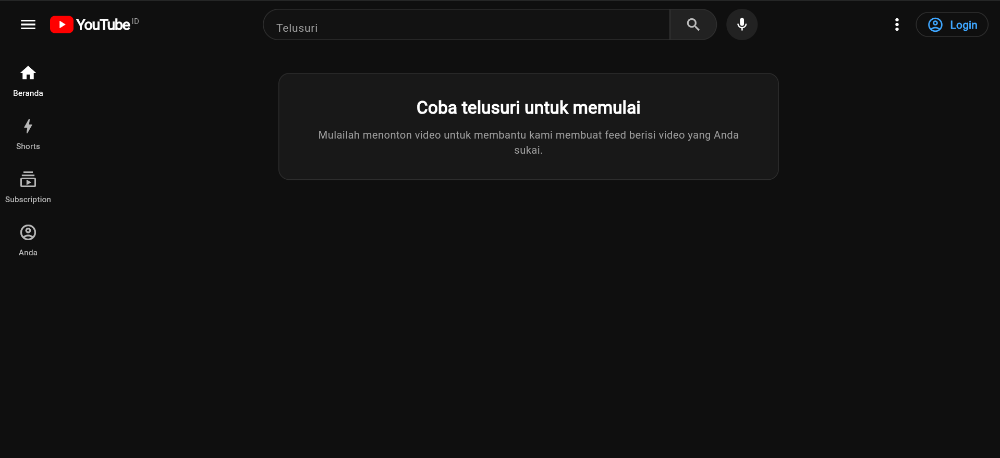
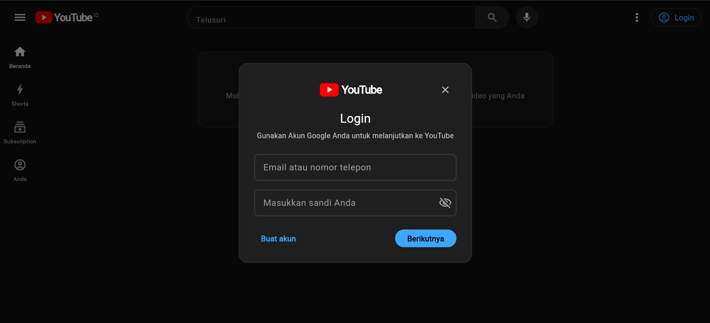
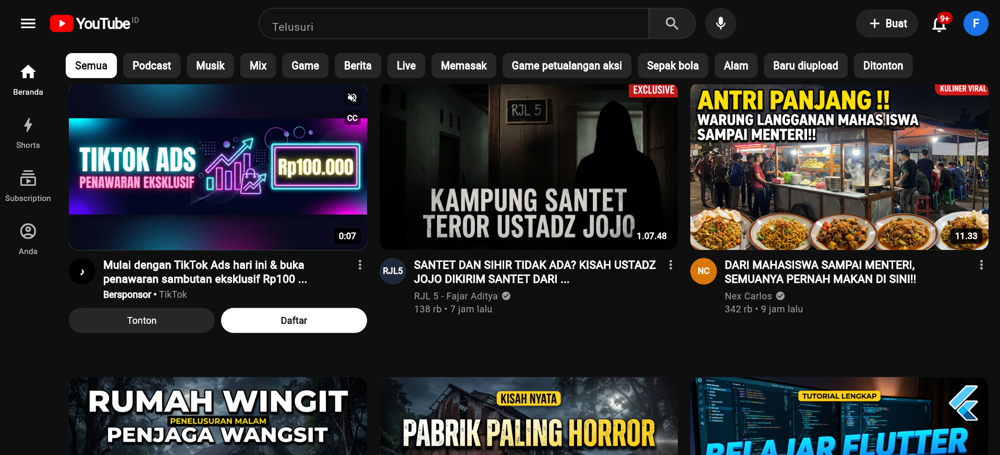
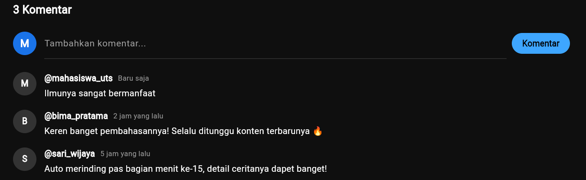

# YouTube Clone (Dark Mode) - Proyek UTS Mobile Programming

Aplikasi kloning antarmuka web/desktop **YouTube Dark Mode** yang dibangun menggunakan framework **Flutter (Dart)**. Proyek ini dibuat untuk memenuhi tugas Ujian Tengah Semester (UTS) mata kuliah Mobile Programming dengan fokus pada presisi antarmuka pengguna (*UI fidelity*), tata letak responsif, dan interaktivitas fitur.

---

## Perjalanan Singkat Pengembangan Proyek

Pengembangan aplikasi ini dilakukan secara bertahap mulai dari perancangan kerangka dasar hingga penyempurnaan detail visual menyerupai YouTube asli:

1. **Perancangan Tema & Halaman Awal (*Logged-Out Landing Page*):** Membangun tampilan awal YouTube Dark Mode (`#0F0F0F`) lengkap dengan mini-sidebar kiri, header atas, kolom pencarian aktif, dan kartu sambutan awal.
2. **Sistem Autentikasi & Validasi Form:** Menambahkan modal dialog Login dan halaman Registrasi dengan validasi input email/nomor telepon, minimal panjang sandi 6 karakter, fitur lihat/sembunyikan sandi, serta integrasi nama pengguna ke profil dashboard.
3. **Dashboard Utama & Pencarian Real-Time:** Menyusun grid video responsif (1–3 kolom mengikuti lebar layar), filter chip kategori horizontal, kartu konten bersponsor, dan fitur pencarian judul maupun nama channel secara langsung.
4. **Halaman Pemutar Video (`WatchScreen`) & Interaktivitas Tambahan:** Mengembangkan halaman detail pemutar video 16:9 yang dilengkapi label *Disulih suara otomatis*, tombol Subscribe dinamis, kapsul gabungan Like/Dislike, menu opsi titik tiga (*Download, Terima kasih, Simpan, Viralkan, Laporkan*), daftar rekomendasi video di sisi kanan, serta kolom komentar interaktif secara *real-time*.

---

## Dokumentasi Tampilan Aplikasi (Screenshots)

### 1. Halaman Awal (Logged-Out Landing Page)
Tampilan awal saat aplikasi pertama kali dibuka sebelum pengguna masuk ke akun.


### 2. Modal Login & Halaman Registrasi
Form autentikasi dengan validasi input dan fitur lihat/sembunyikan kata sandi.


### 3. Dashboard Utama (Dark Mode)
Grid video responsif dengan filter kategori horizontal dan fitur pencarian judul/channel *real-time*.


### 4. Halaman Pemutar Video (`WatchScreen`)
Pemutar video rasio 16:9 dilengkapi kontrol Subscribe, kapsul Like/Dislike, dan daftar video rekomendasi di sisi kanan.


### 5. Menu Opsi Lanjutan & Komentar Interaktif
Menu popup opsi tambahan (*Download, Terima kasih, Simpan, Viralkan, Laporkan*) serta kolom komentar dinamis.


---

## Struktur Folder Proyek

```text
youtube_clone_uts/
├── lib/
│   ├── main.dart                     # Entry point & konfigurasi routing halaman
│   ├── models/
│   │   └── video_model.dart          # Struktur data video & daftar dummy videos
│   └── screens/
│       ├── login_screen.dart         # Halaman awal YouTube & modal dialog Login
│       ├── register_screen.dart      # Halaman pendaftaran akun baru
│       ├── home_screen.dart          # Dashboard utama, filter kategori, & pencarian
│       └── watch_screen.dart         # Halaman pemutar video, menu opsi, & komentar
├── assets/
│   └── images/                       # Aset gambar thumbnail video lokal
├── screenshots/                      # Dokumentasi tangkapan layar aplikasi
└── pubspec.yaml                      # Konfigurasi dependensi dan aset Flutter